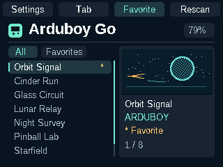
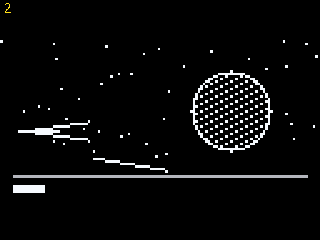
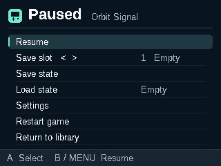
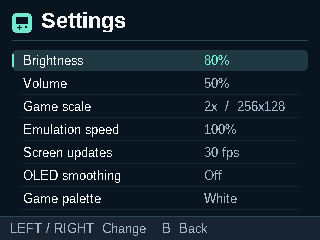

# Arduboy Go

Эмулятор **Arduboy** для оригинальной **Hardkernel ODROID-GO с ESP32**. Игры загружаются с microSD из `/roms/arduboy`.

Ядро Ardens эмулирует ATmega32U4, экран OLED SSD1306, звук и флеш-память отдельных игр Arduboy FX. [Ardens](https://github.com/tiberiusbrown/Ardens)

[Скачать прошивку](https://github.com/AbdulKus/odroid-go-arduboy/releases) · [Характеристики и распиновка](docs/hardware.md)

---

## Скриншоты

Кадры сняты в настольной сборке на тестовой игре Orbit Signal.

| Библиотека игр (Каталог) | Игровой процесс (Масштаб 2x) |
| :---: | :---: |
|  |  |
| **Меню паузы и слоты сохранений** | **Настройки отображения и звука** |
|  |  |

---

## Основные возможности

### Каталог игр и библиотека
* **Рекурсивное сканирование**: библиотека автоматически сканирует каталог `/roms/arduboy` на карте MicroSD на глубину до 8 уровней вложенности.
* До 12 000 записей в каталоге. Для длинных вложенных путей действует общий лимит 768 КиБ на пути и исходные названия.
* **Поддерживаемые форматы**:
  * Пакеты **`.arduboy`** (ZIP-архивы с встроенными метаданными `info.json`, скомпилированным бинарником и графикой).
  * Файлы прошивок **`.hex`** (стандартный формат Intel HEX).
* **Обложки и карточки игр**:
  * Автоматическое чтение встроенных обложек (`banner` / `cover` / `screenshots`) из `.arduboy` архивов.
  * Поддержка внешних файлов обложек `имя_игры.png` рядом с ROM-файлом.
  * Автоматическое создание снимка экрана при выходе из игры в главное меню (сохраняется в `/saves/arduboy/<id>.preview` для быстрого предпросмотра).
* **Избранное**: быстрое добавление игр в список избранного (кнопка `Select`) и мгновенное переключение фильтра «Все / Избранное» (кнопка `Volume`).

### Arduboy FX и система сохранений
* **Отдельные игры Arduboy FX** используют эмуляцию флеш-памяти W25Q128.
  * Суммарный лимит данных FX (`flashdata`) и области сохранения (`flashsave`) составляет **768 КиБ** на игру.
  * Максимальный размер области сохранения FX — **64 КиБ**.
  * Для отдельных `.hex` файлов поддерживаются парные sidecar-файлы: `.bin` (данные FX) и `.save.bin` (сохранения FX).
  * Поддержка FX ограничена отдельными играми. Сборные образы флеш-картриджей требуют другой загрузки.
* **Энергонезависимые сохранения (EEPROM & FX Save)**:
  * При изменении прогресса запись на карту в `/saves/arduboy/` выполняется примерно раз в три секунды, при паузе и выходе из игры.
* **Слоты быстрых сохранений (Save States)**:
  * 3 независимых слота сохранений на каждую игру, доступных из меню паузы.
  * Контроль целостности по CRC32 и проверка идентификатора игры.
  * Автоматическое создание резервных копий (`.bak`) и откат на резервную копию при случайном повреждении основного файла слота.

### Экран, звук и производительность
* **Режимы масштабирования**:
  * `1:1 (Native)` — 128×64 пикселей (оригинальное разрешение экрана Arduboy по центру дисплея).
  * `2x (Double)` — 256×128 пикселей с целочисленным масштабированием.
  * `Fit` — 320×160 пикселей (масштабирование с сохранением пропорций 2:1 на всю ширину дисплея 320×240).
* **Цветовые палитры**: White (классический монохром), Mint (неоново-зеленый оттенок), Amber (янтарный дисплей).
* **Эффект OLED smoothing**: программная имитация отклика и сглаживания свечения пикселей оригинального экрана SSD1306.
* **Настройка Screen updates (FPS: 20, 30, 60)**:
  Верхняя граница частоты передачи кадра на LCD. Скорость AVR настраивается отдельно.
* **Управление скоростью**: возможность замедления или ускорения эмуляции (50%, 75%, 100%, 125%).
* **Аудио**: вывод 8-битного звука через встроенный ЦАП ESP32 (32 кГц) с отключением усилителя во время паузы и при нулевой громкости.

---

## Аппаратная часть ODROID-GO

Прошивка рассчитана на оригинальную консоль **Hardkernel ODROID-GO**:
* **Чип**: ESP32-WROVER (2 ядра Xtensa LX6, прошивка работает на частоте **240 МГц**).
* **Память**: 16 МБ Flash, 4 МБ PSRAM.
* **Экран**: 2.4" 320×240 ILI9341 LCD (SPI на частоте 40 МГц с прерываниями DMA).
* **Питание**: аккумулятор Li-Po 3.7 В, 1200 мА·ч, зарядка по Micro-USB током до 500 мА.
* **Хранилище**: MicroSD через SPI на частоте 20 МГц (шина разделяется с дисплеем).
* **Органы управления**: аналоговая резистивная крестовина на АЦП, цифровые кнопки A, B, Menu, Select, Start, Volume.

Подробная принципиальная схема подключения, таблица контактов и архитектура периферии описаны в документе **[docs/hardware.md](docs/hardware.md)**.

---

## Установка

В [Releases](https://github.com/AbdulKus/odroid-go-arduboy/releases) доступны файл установки `.fw`, образ для USB `.img` и `SHA256SUMS`.

### Установка с microSD
Если на консоли уже установлен стандартный загрузчик Hardkernel или мульти-загрузчик [ducalex/odroid-go-multi-firmware](https://github.com/ducalex/odroid-go-multi-firmware):

1. Скопируйте `arduboy-go-*-odroid-go.fw` в `/odroid/firmware` на microSD с FAT32. Игры положите в `/roms/arduboy`.
2. Вставьте карту памяти в ODROID-GO.
3. Зажмите кнопку **`B`** и включите питание консоли тумблером.
4. В меню прошивок выберите **Arduboy Go**, подтвердите установку и запустите его. При использовании Multi Firmware эмулятор можно установить рядом с другими прошивками.

### Самостоятельная прошивка по USB
Файл полного образа `arduboy-go-*.img` предназначен для автономной прошивки через кабель Micro-USB:
```bash
python3 -m esptool --chip esp32 --port /dev/ttyUSB0 write_flash 0x0 arduboy-go-v0.1.0-odroid-go.img
```
> [!WARNING]
> Прошивка образа `.img` со смещения `0x0` перезаписывает всю таблицу разделов и заменяет текущий загрузчик консоли. Для сохранения мультизагрузочного меню используйте вариант с файлом `.fw`.

---

## Структура файлов на microSD

Игровые ROM добавляются отдельно.

```text
/
├── odroid/
│   └── firmware/
│       └── arduboy-go-v0.1.0-odroid-go.fw    # Файл обновления прошивки
├── roms/
│   └── arduboy/                             # Каталог игр, включая вложенные папки
│       ├── Game1.arduboy                     # Пакет с встроенными ресурсами
│       ├── Game2.hex                         # Обычный Intel HEX файл
│       ├── Game2.png                         # Внешняя обложка (sidecar)
│       ├── Game3_FX.hex                      # Игра с поддержкой FX
│       ├── Game3_FX.bin                      # Данные FX памяти (sidecar)
│       └── Game3_FX.save.bin                 # Область сохранения FX (sidecar)
└── saves/
    └── arduboy/                             # Сохранения игр и настройки
        ├── settings.dat                      # Пользовательские настройки консоли
        ├── favorites.dat                     # Список избранных игр
        ├── <game_id>.preview                 # Кадр для предпросмотра
        ├── <rom_hash>.eep                    # EEPROM и прогресс FX
        └── <rom_hash>.slot1                  # Первый слот состояния
```

---

## Управление

### На консоли ODROID-GO

| Кнопка | В библиотеке игр | Во время игры | В меню паузы / настроек |
| --- | --- | --- | --- |
| **D-Pad (Крестовина)** | Навигация по списку игр (влево/вправо: постранично) | Управление направлением в игре | Перемещение по пунктам меню, изменение значений |
| **Кнопка A** | Запуск выбранной игры | Действие A в игре | Выбор пункта / подтверждение |
| **Кнопка B** | Выход в мультизагрузчик (если доступно) | Действие B в игре | Возврат / отмена |
| **Menu** | Открыть настройки | Открыть меню паузы | Закрыть меню / паузу |
| **Select** | Добавить / удалить из избранного | — | — |
| **Start** | Пересканировать каталог ROM | Открыть меню паузы | Продолжить из паузы |
| **Volume** | Переключить фильтр (Все / Избранное) | Открыть настройки громкости | — |

---

## Десктопная версия (Desktop Runner)

Для быстрой отладки, создания снимков экрана и тестирования функционала без прошивки консоли проект включает нативный SDL2-раннер для настольного компьютера под управлением Linux.

### Установка зависимостей (Ubuntu / Debian)
```bash
sudo apt-get update
sudo apt-get install -y build-essential cmake ninja-build libsdl2-dev gcc-avr avr-libc python3
```

### Сборка и запуск
```bash
# Конфигурация и сборка проекта
cmake -S . -B build-desktop -DARDUGO_DESKTOP=ON -DCMAKE_BUILD_TYPE=Release
cmake --build build-desktop --parallel

# Запуск эмулятора с указанием папки с виртуальной SD-картой
ctest --test-dir build-desktop --output-on-failure
./build-desktop/desktop/arduboy-go-desktop /путь/к/папке/sdcard
```

### Раскладка клавиатуры на ПК

* **Стрелки (Вверх, Вниз, Влево, Вправо)** — крестовина (D-Pad)
* **Z** — Кнопка A
* **X** — Кнопка B
* **Escape** — Кнопка Menu
* **Tab** — Кнопка Volume
* **Backspace** — Кнопка Select
* **Enter (Return)** — Кнопка Start

---

## Сборка прошивки для ESP32 и релизы

Сборка прошивки требует установленного фреймворка **Espressif ESP-IDF v5.4.3**:

```bash
git clone --recursive --branch v5.4.3 --depth 1 https://github.com/espressif/esp-idf.git /path/to/esp-idf
/path/to/esp-idf/install.sh esp32
source /path/to/esp-idf/export.sh
tools/build-firmware.sh dev
```

Скрипт применяет исправление SDSPI к указанной копии ESP-IDF и собирает `.fw`, `.img` и `SHA256SUMS` в `dist/`.

Публикация релизов автоматизирована через GitHub Actions: пуш тега формата `v*` (например, `git tag v0.1.0`) запускает сборку десктопной версии, тестирование CTest, компиляцию прошивки для ESP32 и публикацию файлов в GitHub Releases. Теги `v0.x` и теги с суффиксом публикуются как предварительные релизы.

---

## Статус тестирования

* **Модульные и интеграционные тесты (CTest)**:
  * Полный набор проверок хостового раннера (`tests/check.cpp`) пройден успешно.
  * Фикстура тестирует: эмуляцию команд AVR и регистров, отрисовку буфера SSD1306 OLED, обработку кнопок, генерацию аудио через Timer3, сохранение и восстановление энергонезависимой памяти EEPROM, корректный откат поврежденных файлов слотов на резервные копии `.bak`, работу меню паузы, геометрию масштабирования (Native, Double, Fit) и корректное сканирование тестового каталога из 5 000 файлов без обрезки данных.
* **Совместимость с играми**:
  * На хостовом раннере успешно протестирован запуск пяти эталонных тестовых игр из апстрима Ardens:
    * `arduchess`
    * `ardugolf`
    * `ardugolf_fx`
    * `dazzledash`
    * `summercamp`
  * *(Данные тестовые ROM-файлы используются исключительно для верификации ядра эмулятора и не распространяются в составе данного репозитория).*
* **Эмуляция в QEMU**:
  * Локальная сборка на базе ESP-IDF 5.4.3 успешно протестирована в симуляторе **Espressif QEMU 9.2.2**: прошивка стартует, корректно инициализирует 4 МБ PSRAM и доходит до обработки отсутствующей SD-карты (модель SPI SD-карты не входит в состав периферии QEMU для ESP32). Физическая консоль на этапе тестирования не подключалась.
  * В отдельной проверочной сборке с виртуальной SDMMC-картой при запуске на Xtensa три ROM (одна HEX и две `.arduboy`) вывели кадр. Проверочная HEX-игра прошла тест ввода и восстановления состояния из слота.

---

## Благодарности и ссылки

* [Hardkernel ODROID-GO](https://github.com/hardkernel/ODROID-GO) — схемы, документация и библиотека для аппаратной платформы.
* [ducalex/odroid-go-multi-firmware](https://github.com/ducalex/odroid-go-multi-firmware) — мультизагрузчик прошивок для ODROID-GO.
* [Retro-Go](https://github.com/ducalex/retro-go) — наработки по адаптации драйверов и оптимизации вывода графики.
* [Espressif ESP-IDF](https://github.com/espressif/esp-idf) — официальная среда разработки для микроконтроллеров ESP32.
* [Ardens](https://github.com/tiberiusbrown/Ardens) — открытый эмулятор Arduboy.

## Лицензия

Проект распространяется под [MIT](LICENSE). Версии и лицензии сторонних библиотек перечислены в [third_party/README.md](third_party/README.md).
